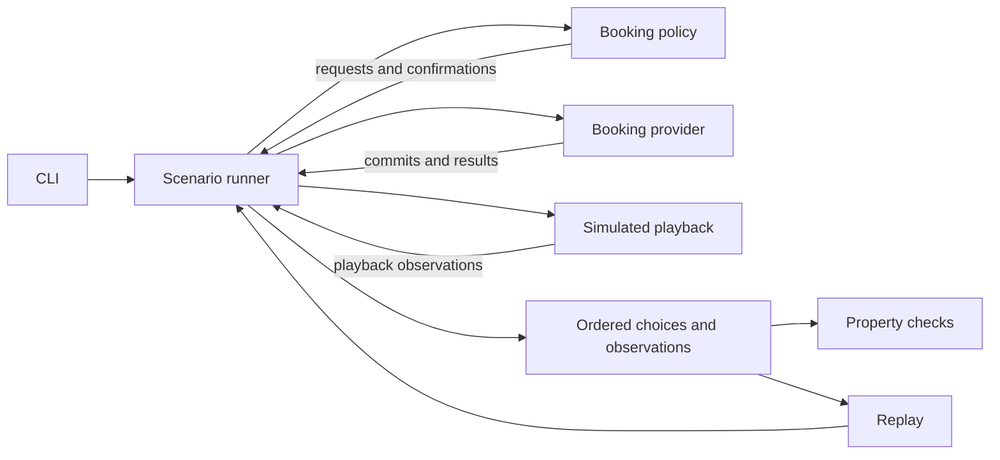

# Architecture

The first demo asks what happens when a caller changes a booking from Tuesday to Thursday while the provider is processing Tuesday. The caller correcting a request, the provider committing the reservation and the agent learning its result are separate events. An agent can make an incorrect promise even when every message arrives.

## The race

Start with the provider holding a pending request for Tuesday. The agent's request to revise the pending booking and the provider's commit can occur in either order.

| Schedule | What happens | What a correct agent must establish |
| --- | --- | --- |
| `correction-first` | The provider accepts the revision while the booking is pending, then commits Thursday. | The commitment for Thursday reaches the agent before its confirmation. Both example policies pass. |
| `commit-first` | The provider commits Tuesday. The attempt to revise the pending booking returns `too-late`. The buggy policy treats that rejection as success and announces Thursday. | The fixed policy requests an amendment to the committed booking. It confirms Thursday once the provider returns the new commitment. |

The healthy outcome of this fixture is one active booking on Thursday and a corresponding final confirmation. Comparing final values catches inconsistencies such as a Thursday confirmation with a Tuesday booking. Examining the timeline explains how the inconsistency arose.

## Boundaries and evidence

| Owner | Authoritative evidence |
| --- | --- |
| Caller | The latest day requested. Delivery of the correction determines when the agent can act on it. |
| Agent | The inputs delivered to it, the operations it requests and the claims it emits. Its own confirmation cannot establish what the provider committed. |
| Provider | The active reservation and changes applied to it. A result delivered to the agent can arrive after the corresponding commit. |
| Device | Playback markers in the simulation. Hearing the word “Thursday” in a real phone call would require recording or measuring real playout. |
| Runner and checks | The selected order, what each participant observed and the resulting verdict. Replay starts from a fresh world and recomputes the outcome. |

TypeScript and Node keep the policy and runner in one process. The scheduler selects an enabled action at the earliest logical tick, after its declared parents have run. The fixture gives the competing actions different tie-break priorities for the two schedules. Explicit delivery makes the race repeatable without sleeping or making a phone call. The policy sees caller input and delivered replies. The checker can also inspect the provider's commits and device playback markers. [Scheduler](../src/core/scheduler.ts) · [Policy](../src/fixtures/booking/agent.ts) · [Provider](../src/fixtures/booking/provider.ts) · [Property checks](../src/checks/booking.ts)

## Reproducing and reviewing a failure

Use the [terminal walkthrough](../README.md) to run the fixture, save its trace and replay it. To review a report, locate the correction, then find the provider commit, the result delivered to the agent and the confirmation presented by the device. Check which facts the agent could have known when it made that claim. First establish whether the saved execution is reproducible. Then inspect whether the booking behavior satisfied its contract. Reproducing a failing scenario is a successful diagnostic outcome.

The first increment should meet these acceptance criteria.

- Run both legal orders with the same caller and provider. A fresh run of a chosen order and policy must yield the same observations.
- Surface a failure of the deliberately faulty policy and a passing run of the corrected policy. Compare provider state and the final confirmation using observations external to the agent.
- Replay saved decisions in a fresh simulation. Reject an invalid schedule or a trace whose recorded observations disagree with the recomputed history.

## Planned extensions

| Increment | New behavior | Evidence needed |
| --- | --- | --- |
| Recovery after a lost reply | Separate provider commit, lost acknowledgement and agent restart. Give the agent a durable journal with a revision and process epoch. | A late write from an old process cannot replace the recovered state. Repeating a logical operation preserves its key. An ambiguous outcome with a provider that cannot deduplicate or answer queries ends in explicit review. |
| Delivery of user intent | Model both one-time delivery and redelivery until durable acknowledgement. | A corrected day persisted before the crash can be recovered. A correction lost from volatile memory requires reconfirmation unless the caller input can be redelivered. |
| Broader exploration and smaller reports | Bound the number of schedules and steps. Reduce a failing schedule while preserving its causal dependencies. | A reduced trace exhibits the same property failure. A cutoff reports incomplete exploration. Pending provider effects and playback are drained before declaring a terminal outcome. |
| Integration outside the fixture | Run a real policy through a cooperative adapter whose controllable boundaries are documented. | Reproduce a decision from external application code in a clean, repeatable run. Real audio latency and perceived interruptions require a separate measurement with a real clock. |
