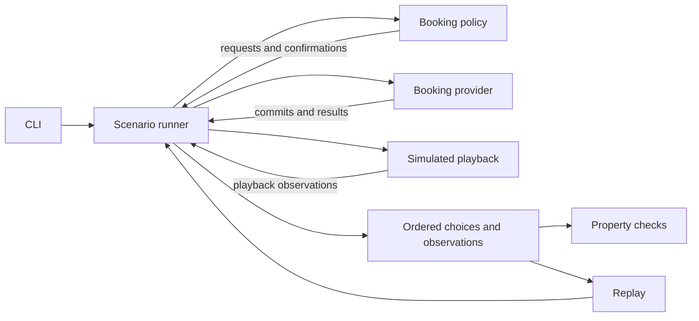

# Architecture

Turntrace records when a caller speaks, when an agent learns something, when a provider changes state and when a device starts playback. A booking can commit before anyone receives its receipt. A confirmation can reach the device after the caller has hung up. The event history keeps these observations distinct.

## Scenario-driven lab

`run` and `explore` take a scenario document with `schemaVersion: 1`. Each run starts a fresh scheduler, caller, journal, provider, device and agent instance. The scenario names the external actions, their virtual release ticks and their causal parents. A cooperative adapter receives only the inputs delivered to its current instance and requests effects through commands. General domain signals can drive a consumer's own policy. An adapter's diagnostic output is identified in the trace by `agent.observed`. [Adapter protocol](adapter.md)

| State owner | Boundary exercised by the lab |
| --- | --- |
| Caller | In recoverable mode the source retains each input ID until its acknowledgement arrives. On restart it redelivers outstanding IDs. Single delivery permits a correction to disappear with a crashed instance. |
| Journal | An atomic write validates the issuing epoch and expected revision. A committed write survives a lost store acknowledgement. A write from the old epoch that arrives after restart is rejected. |
| Provider and transport | Apply, reply release and delivery are distinct actions. An in-flight create or amendment can commit after the agent crashes. Lookup, idempotency and amendment are independent provider capabilities. |
| Device | A flush advances the minimum admissible generation when the device receives it. Before then, a queued Tuesday confirmation can still start even if the provider has since amended the booking to Thursday. After the flush, older fragments cannot start. A fragment already playing at flush is recorded as a remnant. |
| Scheduler and checks | The scheduler drains eligible effects after call end. The independent checker evaluates safety from the observed prefix and evaluates the scenario's progress requirement when the world is quiescent. |

The scheduler branches among enabled actions at a shared virtual tick. `explore` enumerates bounded histories or takes a seeded sample. It counts terminal, blocked and truncated histories, and reports any unexplored prefixes. A bounded run records its effective choices for replay. `minimize` removes optional groups or individual actions together with their dependent optional actions, then reruns the candidate. A smaller witness must reproduce the first failed property and its signature. The reduction reports its budget and whether further candidates remained unresolved. [Scheduler](https://github.com/NachoEstevo/turntrace/blob/v0.1.0/src/lab/engine.ts) · [Verifier](https://github.com/NachoEstevo/turntrace/blob/v0.1.0/src/lab/verify.ts) · [Minimizer](https://github.com/NachoEstevo/turntrace/blob/v0.1.0/src/lab/minimize.ts) · [Acceptance scenarios](acceptance.md)

## Fixed correction fixture

The original demo asks what happens when a caller changes a booking from Tuesday to Thursday while the provider is processing Tuesday. An agent can make an incorrect promise even when every message arrives.

Start with the provider holding a pending request for Tuesday. The agent's request to revise the pending booking and the provider's commit can occur in either order.

| Schedule | What happens | What a correct agent must establish |
| --- | --- | --- |
| `correction-first` | The provider accepts the revision while the booking is pending, then commits Thursday. | The commitment for Thursday reaches the agent before its confirmation. Both example policies pass. |
| `commit-first` | The provider commits Tuesday. The attempt to revise the pending booking returns `too-late`. The buggy policy treats that rejection as success and announces Thursday. | The fixed policy requests an amendment to the committed booking. It confirms Thursday once the provider returns the new commitment. |

The healthy outcome of this fixture is one active booking on Thursday and a corresponding final confirmation. Comparing final values catches inconsistencies such as a Thursday confirmation with a Tuesday booking. Examining the timeline explains how the inconsistency arose.

## Boundaries and evidence

| Owner | Authoritative evidence |
| --- | --- |
| Caller | The latest day requested. Delivery of the correction determines when the agent can act on it. |
| Agent | The inputs delivered to it, the operations it requests and the claims it emits. Its own confirmation cannot establish what the provider committed. |
| Provider | The active reservation and changes applied to it. A result delivered to the agent can arrive after the corresponding commit. |
| Device | Playback markers in the simulation. Hearing the word “Thursday” in a real phone call would require recording or measuring real playout. |
| Runner and checks | The selected order, what each participant observed and the resulting verdict. Replay starts from a fresh world and recomputes the outcome. |

TypeScript and Node keep the policy and runner in one process. The scheduler selects an enabled action at the earliest logical tick, after its declared parents have run. The fixture gives the competing actions different tie-break priorities for the two schedules. Explicit delivery makes the race repeatable without sleeping or making a phone call. The policy sees caller input and delivered replies. The checker can also inspect the provider's commits and device playback markers. [Scheduler](https://github.com/NachoEstevo/turntrace/blob/v0.1.0/src/core/scheduler.ts) · [Policy](https://github.com/NachoEstevo/turntrace/blob/v0.1.0/src/fixtures/booking/agent.ts) · [Provider](https://github.com/NachoEstevo/turntrace/blob/v0.1.0/src/fixtures/booking/provider.ts) · [Property checks](https://github.com/NachoEstevo/turntrace/blob/v0.1.0/src/checks/booking.ts)

## Reproducing and reviewing a failure

Use the [terminal walkthrough](../README.md) to run the fixture, save its trace and replay it. To review a report, locate the correction, then find the provider commit, the result delivered to the agent and the confirmation presented by the device. Check which facts the agent could have known when it made that claim. First establish whether the saved execution is reproducible. Then inspect whether the booking behavior satisfied its contract. Reproducing a failing scenario is a successful diagnostic outcome.

The fixed fixture's regression tests exercise the following cases.

- Run both legal orders with the same caller and provider. A fresh run of a chosen order and policy must yield the same observations.
- Surface a failure of the deliberately faulty policy and a passing run of the corrected policy. Compare provider state and the final confirmation using observations external to the agent.
- Replay saved decisions in a fresh simulation. Reject an invalid schedule or a trace whose recorded observations disagree with the recomputed history.

## Fixed recovery fixture

The recovery fixture follows a single request for Thursday. The agent saves the day and operation key, waits for the store acknowledgement and sends a create request. The provider commits the booking. The transport drops the reply before delivery, then the first agent instance crashes. The second instance starts with the saved intent and an unresolved booking outcome. [Recovery runner](https://github.com/NachoEstevo/turntrace/blob/v0.1.0/src/fixtures/recovery/index.ts)

| Owner | Evidence across the restart |
| --- | --- |
| Agent store | Revision 1 holds `Thursday` and `booking-operation-1`. The new instance reads a copy. |
| Provider | Its booking survives the crash. In idempotent mode the provider also retains the original result for the key and payload. |
| Transport | The drop consumes the reply to `attempt-1`. Its receipt remains visible in the diagnostic trace. |
| Agent | Each instance has its own epoch and outstanding attempt. The first instance's volatile state is discarded. |

With the idempotent provider, the safe policy sends `attempt-2` using the saved key and day. The provider returns the original receipt for `booking-1` in a new reply addressed to epoch 2. The agent checks the epoch, attempt, key and day before emitting a Thursday confirmation. The device then records playback. [Recovery policy](https://github.com/NachoEstevo/turntrace/blob/v0.1.0/src/fixtures/recovery/agent.ts) · [Provider](https://github.com/NachoEstevo/turntrace/blob/v0.1.0/src/fixtures/recovery/provider.ts)

With the opaque provider, lookup and deduplication are both unavailable. The safe agent records an unknown outcome and requests human review. It issues no second create or booking confirmation. A person inspecting the trace can see the original commit even while the agent's uncertainty is justified.

The `blind-retry` policy creates a fresh key after the crash. Both providers commit a second booking for the same intent. The checker reconstructs commitments independently and reports the duplicate even though the agent has a genuine receipt for the second booking. [Recovery checks](https://github.com/NachoEstevo/turntrace/blob/v0.1.0/src/checks/recovery.ts)

Durability here means that the simulated store and provider outlive an agent instance inside one CLI process. The run exercises one crash after the first commitment and one dropped reply. Human review ends at the recorded handoff. [Store](https://github.com/NachoEstevo/turntrace/blob/v0.1.0/src/fixtures/recovery/store.ts)

## Trace formats and coverage

The outer trace version selects the matching replay implementation. Each replay checks the implementation identity, rebuilds a fresh world, executes the recorded choices and compares the resulting evidence, checks and digest with the saved history.

| Trace `schemaVersion` | Recorded case |
| --- | --- |
| 1 | Fixed correction fixture with one of the two named schedules and the buggy or fixed policy. |
| 2 | Fixed recovery fixture with the selected provider and restart policy. |
| 3 | Scenario-driven lab. The trace embeds the scenario document, whose own schema version is 1, and records the run limits, choices, status and observations. Replaying an external adapter requires its trusted path and matching fingerprint. |

The world models one call and cooperating actors inside one Node process. The store is durable across simulated agent restarts. Operating-system crashes, SDK internals, human handling after handoff and physical audio are outside the model. With `expectation:"observe"`, a passing result establishes the applicable lab safety properties. A consumer must evaluate its own policy's diagnostic outputs against its domain contract. [Version dispatch](https://github.com/NachoEstevo/turntrace/blob/v0.1.0/src/index.ts) · [Lab trace](https://github.com/NachoEstevo/turntrace/blob/v0.1.0/src/lab/trace.ts)
